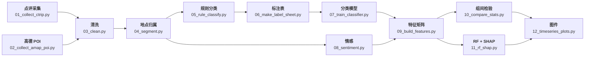

<div align="center">

# 乌镇双栅游客情感对比

**Sentiment on Both Sides of Wuzhen: Dongzha vs. Xizha**

**Zane Zhang（张永轩）**

上海师范大学 · 环境与地理科学学院 · 地理信息科学

大学生创新创业训练计划 · 已结题

[🌐 项目主页](https://zhangyx0803.github.io/projects/wuzhen-twin-gate/) |
[💻 代码](code/) |
[📊 数据](#-数据) |
[📧 联系](#-contact)

*同一座古镇，两道门：13 个脚本从公开点评走到组间检验*

</div>

---

## 🔥 News

- **[2026-11]** 项目结题；配套软件 **DEA 分析工作台系统** 登记软件著作权（2026SR1091537）
- **[2026-10-15]** 景区经营数据 2016–2024 汇总、两栅对比方法学报告完成
- **[2026-09-30]** 采集、清洗、主题分类三个脚本跑通

> 本仓库只放代码，不放原始点评与 POI 数据。

---

## 🌟 这是什么

东栅偏原住民生活与观光，西栅偏度假与夜游；门票、业态、空间组织都不同。
本项目从公开点评出发，回答三个问题：

1. 两栅游客的情感倾向是否有显著差异？
2. 差异集中在哪些体验维度（餐饮、住宿、拥挤、夜景、服务、价格）？
3. 差异是否随季节与年份变化？

---

## ✨ 方法要点

- **规则 + 模型并行**：21 类主题词规则作可解释基线，分类模型接住长尾表达
- **组间检验做多重比较校正**：卡方 / Mann-Whitney U + FDR，避免「21 个主题里挑三个显著」
- **双指标解释**：置换重要性与 SHAP 同时报告，避免单指标误判
- **可复现**：所有路径、词典与 Key 集中在 `code/config.py`

---

## 🔧 流程



---

## 🚀 快速开始

### Step 1 — 环境

```bash
pip install -r requirements.txt
python code/00_check_env.py
```

Python 3.9+。有 OpenAI Key 走 API 情感后端；没有则自动降级到本地词典。

### Step 2 — 采集

```bash
python code/01_collect_ctrip.py     # 点评：先复制浏览器 cURL 到本地文件
python code/02_collect_amap_poi.py  # 周边 POI
```

采集脚本支持断点续采，中断后重跑不会重复。

### Step 3 — 清洗与归属

```bash
python code/03_clean.py      # 去重、去广告、剔除重复景区简介
python code/04_segment.py    # 东栅 / 西栅 / 双栅 + 分句
```

### Step 4 — 主题分类

```bash
python code/05_rule_classify.py       # 21 类规则基线
python code/06_make_label_sheet.py    # 分层抽样，生成人工标注表
python code/07_train_classifier.py    # 训练后全量预测
```

### Step 5 — 情感与建模

```bash
python code/08_sentiment.py        # 情感得分
python code/09_build_features.py   # 随机森林特征矩阵
python code/10_compare_stats.py    # 卡方 / Mann-Whitney U / FDR
python code/11_rf_shap.py          # 置换重要性 + SHAP + 偏依赖
```

### Step 6 — 出图

```bash
python code/12_timeseries_plots.py  # 时间序列与 300 dpi 图件
```

---

## 🗂️ 仓库结构

```text
code/
  00_check_env.py          环境自检
  01_collect_ctrip.py      点评采集（cURL 驱动，可续采）
  02_collect_amap_poi.py   高德 POI 采集
  03_clean.py              清洗与去重
  04_segment.py            地点归属与分句
  05_rule_classify.py      21 类主题词规则分类
  06_make_label_sheet.py   分层抽样标注表
  07_train_classifier.py   分类模型训练与预测
  08_sentiment.py          情感分析（API / 本地词典）
  09_build_features.py     特征矩阵
  10_compare_stats.py      组间检验
  11_rf_shap.py            随机森林 + SHAP
  12_timeseries_plots.py   时间序列与出图
  config.py                路径、词典、Key 集中配置
  textutil.py              文本工具
requirements.txt
```

---

## 📊 数据

| 数据 | 内容 | 用途 |
| --- | --- | --- |
| 景区游客点评 | 文本、评分、时间、地点 | 主数据 |
| 高德 POI | 周边业态与设施 | 业态对照 |
| 人工标注样本 | 分层抽样后人工标主题 | 训练与校验 |
| 经营数据 | 2016–2024 年度口径 | 背景对照 |

原始点评与 POI 受平台条款约束，不随仓库分发；样例数据与标注表可按需提供。

---

## 📧 Contact

如需数据或合作，请联系：<zhangyx0803@petalmail.com>

个人主页：<https://zhangyx0803.github.io/>
