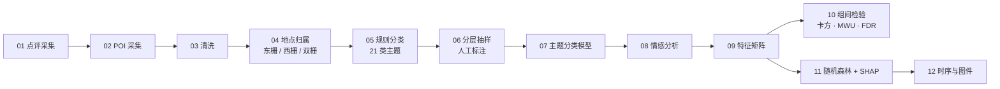

# 乌镇东栅 / 西栅 游客情感对比研究

**Twin Gates, Two Moods: Sentiment Comparison of Tourists in Wuzhen East & West Scenic Areas**

<p>
  
  
  
</p>

---

## 这是什么 / What this is

同一个古镇、同一条水，**东栅与西栅**的游客体验并不相同：东栅偏原住民生活与观光，西栅偏度假与夜游，
门票、业态与空间组织都不一样。本项目用公开点评数据，量化两栅游客情感的差异及其维度来源。

*Same water town, two gates. This project quantifies how tourist sentiment differs between Wuzhen's East and West
scenic areas — and which experience dimensions drive the difference.*

> 仓库只提供**分析代码**；原始点评、POI 与操作手册均未公开。
> *Only the analysis code is published. Raw reviews, POIs and the internal manual are not included.*

---

## 分析流程 / Pipeline



| # | 脚本 | 作用 |
| --- | --- | --- |
| 0 | `00_check_env.py` | 环境自检 |
| 1 | `01_collect_ctrip.py` | 点评采集（cURL 驱动 + 翻页 + 断点续采） |
| 2 | `02_collect_amap_poi.py` | POI 采集 |
| 3 | `03_clean.py` | 去重、去广告 |
| 4 | `04_segment.py` | 地点归属与分句 |
| 5 | `05_rule_classify.py` | 主题词规则分类（基线） |
| 6 | `06_make_label_sheet.py` | 分层抽样生成标注表 |
| 7 | `07_train_classifier.py` | 训练与评估分类模型 |
| 8 | `08_sentiment.py` | 情感分析（后端可切换） |
| 9 | `09_build_features.py` | 特征矩阵 |
| 10 | `10_compare_stats.py` | 组间检验（卡方 / MWU / FDR） |
| 11 | `11_rf_shap.py` | 分组建模、置换重要性、SHAP |
| 12 | `12_timeseries_plots.py` | 时间序列与图件 |

---

## 快速开始 / Quick start

```bash
python -m pip install -r requirements.txt
python code/00_check_env.py
python code/01_collect_ctrip.py --help
```

需要 Python **3.9+**（推荐 3.10–3.12）。`requirements-py37.txt` 仅供旧环境兜底。

> 运行前请自行准备数据：点评采集需要浏览器里的 cURL 请求；情感分析可填自己的 API Key，
> 也可以切换到本地词典后端在无 Key 的情况下降级运行。所有凭据都留空在 `code/config.py` 里。

---

## 方法备注 / Method notes

- **规则分类与模型分类并行**：规则分类是可解释的基线，模型覆盖长尾表达。
- 组间检验用卡方 / Mann-Whitney U，并做 FDR 多重比较校正。
- 重要性解释同时给置换重要性与 SHAP 值，避免单指标误判。
- 情感分析保留多个可切换后端，便于在不同 Key 条件下运行。
