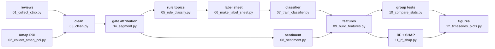

<div align="center">

# Sentiment on Both Sides of Wuzhen

**Dongzha vs. Xizha: resource-use efficiency and visitor sentiment**

**Zane Zhang**

Shanghai Normal University · School of Environmental and Geographical Sciences

Undergraduate Innovation and Entrepreneurship Programme · completed

[🌐 Project page](https://zhangyx0803.github.io/projects/wuzhen-twin-gate/) |
[💻 Code](code/) |
[📊 Data](#-data) |
[📧 Contact](#-contact)

*One historic town, two gates: thirteen scripts from public reviews to group tests*

</div>

---

## 🔥 News

- **[2026-10]** Programme concluded; the companion tool **DEA Analysis Workbench** is registered as a software copyright (2026SR1091537).
- **[2026-10]** Annual operating figures 2016–2024 compiled; method review comparing the two gates completed.
- **[2026-04]** Project started: a comparative study of resource conversion efficiency in historic towns under living-heritage preservation and integrated operation, with Wuzhen Dongzha and Xizha as the case pair.

> This repository contains code only. Raw reviews and POI data are not distributed.

---

## 🌟 What this is

Wuzhen's two gates run on different models: Dongzha on living-heritage preservation and sightseeing, Xizha on
integrated operation and night tourism. Tickets, business mix and spatial organisation all differ.
The project asks two questions with data:

1. **Efficiency** — how do the two gates differ in resource conversion efficiency and total factor productivity (DEA-Malmquist, 2016–2024)?
2. **Experience** — is visitor sentiment significantly different between the gates, along which dimensions
   (food, lodging, crowding, night scenes, service, price), and does the gap vary by season and year?

---

## ✨ Method highlights

- **Rules and a model side by side** — 21 keyword topics give an interpretable baseline; a trained classifier catches long-tail phrasing.
- **Multiple-testing correction** — chi-square / Mann-Whitney U with FDR control, so "three significant topics out of twenty-one" does not happen by luck.
- **Two importance measures** — permutation importance and SHAP reported together.
- **Reproducible** — every path, lexicon and key lives in `code/config.py`.

---

## 🔧 Pipeline



---

## 🚀 Quick start

### Step 1 — Environment

```bash
pip install -r requirements.txt
python code/00_check_env.py
```

Python 3.9+. With an OpenAI key the sentiment stage uses the API backend; without one it falls back to a local lexicon.

### Step 2 — Collect

```bash
python code/01_collect_ctrip.py     # reviews: paste a browser cURL into a local file first
python code/02_collect_amap_poi.py  # nearby POI
```

Collection is resumable: rerunning after an interruption does not duplicate records.

### Step 3 — Clean and attribute

```bash
python code/03_clean.py     # deduplicate, drop ads, remove repeated introductions
python code/04_segment.py   # gate labels (Dongzha / Xizha / both) and sentence splitting
```

### Step 4 — Topic classification

```bash
python code/05_rule_classify.py      # 21-topic rule baseline
python code/06_make_label_sheet.py   # stratified sample for manual labelling
python code/07_train_classifier.py   # train, then predict on the full corpus
```

### Step 5 — Sentiment and modelling

```bash
python code/08_sentiment.py       # sentiment scores
python code/09_build_features.py  # feature matrix for the random forest
python code/10_compare_stats.py   # chi-square / Mann-Whitney U / FDR
python code/11_rf_shap.py         # permutation importance, SHAP, partial dependence
```

### Step 6 — Figures

```bash
python code/12_timeseries_plots.py  # time series and 300 dpi figures
```

---

## 🗂️ Repository layout

```text
code/
  00_check_env.py          environment check
  01_collect_ctrip.py      review collection (resumable, cURL driven)
  02_collect_amap_poi.py   POI collection
  03_clean.py              cleaning and deduplication
  04_segment.py            gate attribution and sentence splitting
  05_rule_classify.py      21-topic keyword classifier
  06_make_label_sheet.py   stratified labelling sheet
  07_train_classifier.py   classifier training and prediction
  08_sentiment.py          sentiment (API or local lexicon)
  09_build_features.py     feature matrix
  10_compare_stats.py      group tests
  11_rf_shap.py            random forest + SHAP
  12_timeseries_plots.py   time series and figures
  config.py                paths, lexicons, keys
  textutil.py              text helpers
dea/
  DEA_Malmquist_test_0_*.m MATLAB scripts for the DEA-Malmquist efficiency stage
requirements.txt
```

Paths in the scripts were rewritten to relative folders before publication; point `config.py` at your own data root.

---

## 📊 Data

| Dataset | Content | Role |
| --- | --- | --- |
| Visitor reviews | text, rating, date, gate | primary data |
| Amap POI | nearby businesses and facilities | business-mix context |
| Manual labels | stratified sample, hand-tagged topics | training and validation |
| Operating figures | annual, 2016–2024 | background |

Reviews and POI are bound by platform terms and are not distributed; sample sheets are available on request.

---

## 📧 Contact

For data or collaboration: <zhangyx0803@petalmail.com>

Homepage: <https://zhangyx0803.github.io/>
